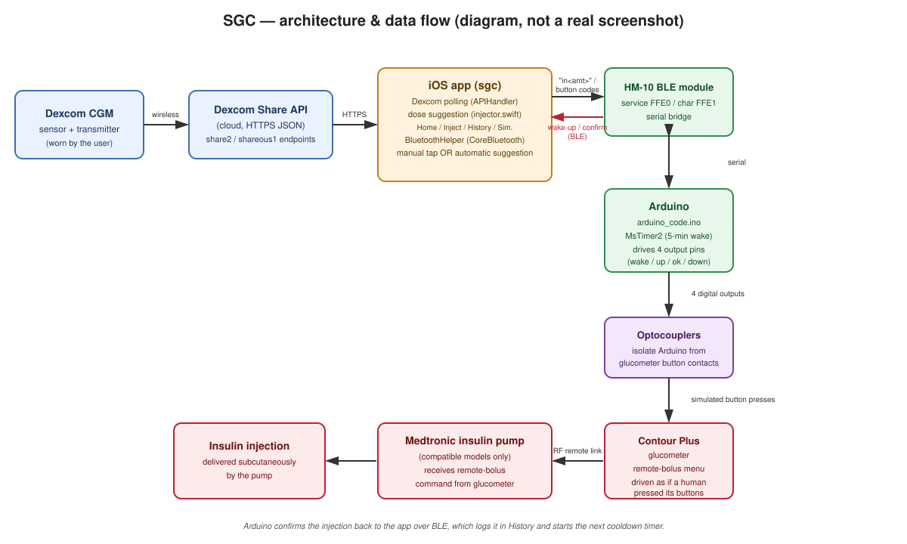
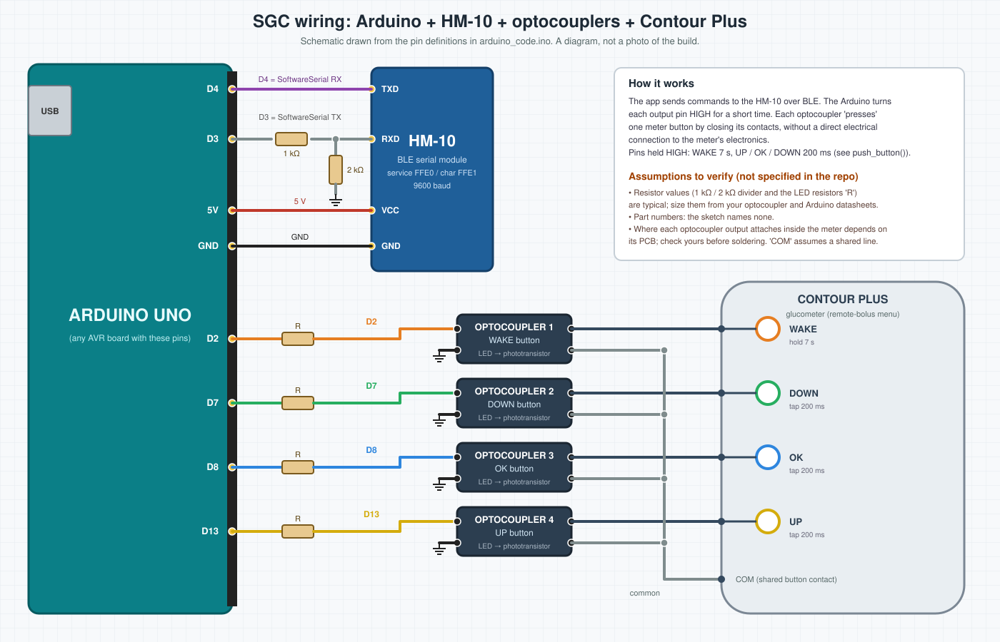

# SGC — Smart Glucose Control

A personal hobby project: an iOS app (Swift/UIKit) paired with an Arduino that lets its
single user view their Dexcom CGM glucose readings and remotely trigger an insulin bolus
on a Contour Plus glucometer's remote-bolus feature — either by tapping a button in the
app, or automatically, on a timer, based on the current glucose reading.

> **⚠️ Disclaimer:** This is a personal DIY project built for one person's own use. It is
> **not a certified medical device**, has **no regulatory approval**, and this README makes
> **no claim about its accuracy, reliability, or safety**. It is **not medical advice**.
> Do not build or use this to manage your own or anyone else's insulin dosing without full
> understanding of the code and hardware involved, and guidance from a qualified healthcare
> professional.

## Overview

SGC is made of two parts that live in this repository:

- **`sgc/`** — an iOS app (UIKit storyboards, no CocoaPods/SwiftPM
  dependencies) that logs into Dexcom's Share API to read glucose values, and talks to an
  Arduino over Bluetooth Low Energy (BLE) to request insulin boluses and read back status.
- **`arduino_code.ino/`** — an Arduino sketch that receives commands over BLE and drives
  four digital output pins. Those pins are wired through optocouplers to the physical
  button contacts of a Contour Plus glucometer, so the Arduino can "press" the
  glucometer's buttons the same way a person would, including the sequence that triggers a
  **remote bolus** on a paired, compatible Medtronic insulin pump.

In other words: the Arduino does not inject anything itself or talk to the pump directly —
it operates the glucometer's own remote-bolus UI by electrically simulating button presses,
and the glucometer/pump pair does the rest. See [How it works](#how-it-works) below for the
exact sequence, and the [architecture diagram](#architecture--data-flow).

## Features

Based on what the code in this repository actually implements:

- **Live Dexcom glucose data** — `DexcomApi/APIHandler.swift` authenticates against the
  Dexcom Share API (`share2.dexcom.com` or `shareous1.dexcom.com` for outside-USA accounts)
  and fetches recent glucose readings (value, trend arrow, timestamp).
- **Manual injection (Inject tab)** — three preset amounts (1.0 / 2.0 / 3.0 units) plus a
  +/− stepper (0.0–5.0 units, in 0.1-unit steps), a big "inject" button that sends the
  amount to the Arduino over BLE, and an on-screen animated status indicator while the
  injection sequence runs.
- **Automatic injection loop** — the Arduino sends a "wake up" signal to the phone every 5
  minutes. If at least 50 minutes have passed since the last confirmed injection, the app
  fetches the latest glucose reading and computes a suggested dose; if the dose is greater
  than zero it is sent to the Arduino the same way as a manual injection. See
  [Automatic dosing logic](#automatic-dosing-logic) for the exact formula.
- **History tab** — a rolling log of confirmed injections (timestamp + amount), capped to
  roughly two days' worth of entries.
- **Home tab** — shows the time/amount of the last injection, and the time of the last
  automatic schedule check; the "last schedule" label turns red if more time than expected
  has passed without a check (a hint that something — e.g. BLE, the app being backgrounded,
  or low-power mode — may have stopped the automatic loop).
- **Simulator tab** — lets the user directly send the individual "up" / "ok" / "down" /
  "wake up" button codes to the Arduino, independent of the injection logic. Useful for
  testing the Bluetooth link and the glucometer wiring without triggering a real bolus.
- **Connection status indicator** — the app's tab bar background changes color
  (red / orange / green) to reflect the current BLE connection state to the Arduino.
- **Background operation** — the app declares the `bluetooth-central` and `fetch`
  background modes and registers a `BGAppRefreshTask`, so the automatic loop can keep
  running (within iOS's background-execution limits) while the app isn't in the
  foreground. Per the original project notes, this does **not** work if the phone is in
  Low Power Mode.
- **Settings tab** — present in the UI (its own tab and storyboard screen) but currently an
  empty stub (`SettingsVC.swift` has no logic beyond `viewDidLoad`). There is no persisted
  settings/database layer; all tunable values (target glucose range, insulin factor,
  cooldown time, etc.) are hardcoded Swift constants in `injector.swift`.

## How it works

### Data flow, step by step

1. The user's Dexcom CGM sensor/transmitter uploads glucose readings to Dexcom's cloud.
2. The iOS app periodically calls the Dexcom Share API over HTTPS to fetch the latest
   glucose value, trend, and timestamp (`Dexcom.getLatestGlucoseReading()`).
3. The app is connected over Bluetooth LE to an HM-10 serial module (service UUID `FFE0`,
   characteristic `FFE1`) wired to the Arduino, using a simple text/byte protocol:
   - App → Arduino: `"in<amount>"` to request an injection of `<amount>` (an integer in
     tenths of a unit), or a single-character code (`"0"` = OK, `"1"` = up, `"2"` =
     wake/turn on, `"3"` = down) to simulate an individual button press.
   - Arduino → App: the byte `11` every 5 minutes (a "wake up and check" tick, driven by
     the `MsTimer2` library), and the byte `101` once an injection sequence has finished
     (a confirmation, not a verified readout from the pump — see
     [Limitations](#known-limitations--things-not-implemented)).
4. On receiving an injection request, the Arduino drives four digital output pins
   (wake-up, up, ok, down) connected through optocouplers to the glucometer's physical
   button contacts, running this sequence (see `arduino_code.ino.ino`'s `inject()`):
   wake the device → wait ~15s (simulated "low battery" screen delay) → press OK twice to
   enter the remote-bolus menu → wait ~15s for the glucometer to connect to the pump →
   press "up" once per tick of the requested amount (the app's UI formats that amount as
   tenths of a unit, e.g. amount `10` displays as `1.0` — which only matches the actual
   dose delivered if the glucometer's own menu increments by the same 0.1-unit step per
   button press; this repository does not verify that assumption in code) → press OK
   twice to confirm → wait ~15s again → press OK once more to return to the main menu →
   wake the device again.
5. The glucometer (a Contour Plus unit with Medtronic remote-bolus support) sends the
   confirmed bolus command over its own RF link to a compatible, paired Medtronic insulin
   pump, which performs the actual subcutaneous injection.
6. Once the Arduino's button sequence completes, it sends the confirmation byte back to
   the phone, which posts an `InjectionConfirmation` notification; the Home, Inject, and
   History screens all update from that single event, and `injector.swift` resets its
   "last injection" timestamp for the 50-minute cooldown.

### Automatic dosing logic

All of this lives in `sgc/injector.swift` and is **not** derived from any medical guidance
in this repository — it's a fixed arithmetic rule the project's author wrote for their own
use:

- Target glucose = midpoint of a hardcoded range, `(130 + 90) / 2 = 110` (mg/dL in the
  code's units).
- If less than 50 minutes have passed since the last confirmed injection, suggest 0.
- If the latest glucose reading is at or below the target, suggest 0 (no correction when
  glucose isn't above target — there is no separate low-glucose/hypoglycemia handling
  beyond this).
- Otherwise, suggested amount = `(glucose − target) / factor`, where `factor` is `10.0`
  normally, or `7.0` if glucose is `≥ 180`.
- If no glucose reading is available within the last 5 minutes, the app logs an API error
  on the Home screen and suggests 0.

### Architecture / data flow



*(This is a diagram illustrating how the pieces connect and what messages flow between
them — not a photo of the real hardware or a screenshot of the app. Real device/app
photos and screenshots can be added here once available.)*

## Hardware requirements

- An iPhone capable of running iOS 15.5+ (the Xcode project's deployment target; the app also uses `BackgroundTasks`/`BGAppRefreshTask`,
  which needs iOS 13 or later), with Bluetooth LE.
- A Mac running Xcode, to build and install the app (there is no other distribution
  mechanism in this repo — no TestFlight/App Store configuration).
- A Dexcom CGM with an active Dexcom Share/follower-enabled account (the app only
  authenticates against Dexcom's Share API, not Apple Health or any local reader).
- An Arduino board (the sketch uses `MsTimer2` and `SoftwareSerial`, both of which assume
  an AVR-based board such as an Uno; `SoftwareSerial` pins are set to RX=4, TX=3 in code).
- An HM-10 (or HM-10-compatible) BLE serial module wired to the Arduino's software serial
  pins.
- Optocouplers wired between four Arduino digital output pins (wake-up, up, ok, down in
  the code) and the corresponding button contacts inside a **Contour Plus** glucometer.
- A Contour Plus glucometer with remote-bolus capability, paired with a **compatible
  Medtronic insulin pump** (per the original project notes, this only works with some
  Medtronic pump models — this repository does not document which ones).

See [Wiring the Arduino](#wiring-the-arduino) for a wiring diagram. It is drawn from the
pin definitions in the sketch; the physical build details the repository never documented
(component values, exactly where each optocoupler attaches inside the meter) are listed as
assumptions to verify, not stated as fact.

## Wiring the Arduino



*(A schematic-style diagram, not a photo of the build.)*

Pin map, taken directly from `arduino_code.ino`:

| Arduino pin | Connects to | Behaviour in the sketch |
|---|---|---|
| D4 | HM-10 **TXD** | `SoftwareSerial` RX (Arduino receives here) |
| D3 | HM-10 **RXD** | `SoftwareSerial` TX (Arduino sends here) |
| 5V / GND | HM-10 VCC / GND | power and common ground |
| D2 | Optocoupler 1 (**wake**) | held HIGH for 7 s |
| D7 | Optocoupler 2 (**down**) | held HIGH for 200 ms |
| D8 | Optocoupler 3 (**ok**) | held HIGH for 200 ms |
| D13 | Optocoupler 4 (**up**) | held HIGH for 200 ms (also the Uno's onboard LED) |

Each optocoupler's LED side is driven by its Arduino pin through a resistor, and its
phototransistor side closes the contacts of the matching glucometer button, so the meter
sees a normal button press.

**Assumptions to verify before you build — none of these are specified in the repo:**

- Resistor values and optocoupler part numbers. The diagram's 1 kΩ / 2 kΩ divider on D3
  (HM-10 modules use 3.3 V logic) and the series resistors "R" are typical choices, not
  taken from the original build. Size them from your parts' datasheets.
- Where each optocoupler output attaches inside the Contour Plus. This depends on the
  meter's PCB, and the diagram's shared "COM" line assumes the buttons switch to a common
  contact. Check your own meter before soldering or modifying it, which may void its
  warranty.

## Software requirements

- Xcode (a version that supports Swift/UIKit targeting iOS 15.5; no specific minimum is
  pinned in the project).
- No CocoaPods, Swift Package Manager dependencies, or Realm — `sgc.xcodeproj` is a plain
  UIKit + CoreBluetooth + BackgroundTasks project with no third-party packages.
- Arduino IDE, plus the **MsTimer2** library installed via the IDE's Library Manager
  (`SoftwareSerial` ships with the IDE already).

## Setup

1. **Clone this repository.**
2. **iOS app:**
   - Open `sgc.xcodeproj` in Xcode.
   - Set your own signing team/bundle identifier if needed.
   - Enter your Dexcom Share credentials in `sgc/DexcomApi/conts.swift`
     (`DexcomApi_username`, `DexcomApi_password`), and set `DexcomApi_outsideUSA` to match
     your Dexcom account's region. These values are blank in the repository — **do not
     commit real credentials**; keep them local only.
   - Build and run on a physical iPhone (CoreBluetooth/BLE hardware isn't available in the
     iOS Simulator).
3. **Arduino:**
   - Install the `MsTimer2` library via Arduino IDE → Tools → Manage Libraries.
   - Open `arduino_code.ino/arduino_code.ino.ino` and upload it to your board.
   - Wire the HM-10 module and the optocouplers as shown in
     [Wiring the Arduino](#wiring-the-arduino) (pin numbers are defined at the top of
     the sketch).
4. **Pairing:** on launch, the app scans for any BLE peripheral advertising service UUID
   `FFE0` and connects to the strongest signal it finds — there's no manual device-picker
   UI.

## Project structure

```
sgc/
├── README.md
├── docs/
│   └── images/
│       ├── architecture.svg          # architecture/data-flow diagram (this README)
│       └── wiring.svg                # Arduino / HM-10 / optocoupler / meter wiring diagram
├── arduino_code.ino/
│   └── arduino_code.ino.ino          # Arduino sketch: BLE protocol + button-press sequencing
├── sgc.xcodeproj/                    # Xcode project (no CocoaPods/SwiftPM)
└── sgc/                              # iOS app source
    ├── AppDelegate.swift             # app lifecycle, BGAppRefreshTask registration
    ├── SceneDelegate.swift
    ├── TabBarController.swift        # wires up BluetoothHelper/Dexcom/injector singletons
    ├── injector.swift                # automatic dosing formula + cooldown logic
    ├── HomeScreen/HomeVC.swift        # last injection / last schedule status
    ├── InjectionScreen/InjectVC.swift # manual dose entry + send
    ├── HistoryScreen/HistoryVC.swift  # injection log
    ├── SettingsScreen/SettingsVC.swift# empty stub, no logic yet
    ├── SimulatorScreen/SimulatorVC.swift # manual button-code sender (test/debug)
    ├── BluetoothHandler/
    │   ├── BluetoothSerial.swift     # generic HM-10/CoreBluetooth serial wrapper
    │   └── BluetoothHelper.swift     # app-specific BLE protocol (injection + button codes)
    ├── DexcomApi/
    │   ├── APIHandler.swift          # Dexcom Share API client
    │   └── conts.swift               # Dexcom endpoints, credentials (blank), constants
    └── Base.lproj/                   # Main.storyboard (5 tabs) + LaunchScreen
```

## Known limitations / things not implemented

Carried over from the original project notes, plus what's visible in the current code:

- The Settings tab has no functionality yet — all tuning constants are hardcoded in
  `injector.swift` and require editing Swift code and rebuilding to change.
- There's no persisted settings/database layer — history is kept only in memory for the
  current app session (it's rebuilt from scratch, empty, on every launch).
- The Arduino's injection "confirmation" only means the button-press sequence finished
  executing — the app has no way to verify from the Arduino that the pump actually
  received or delivered the dose.
- The automatic dosing formula (see [above](#automatic-dosing-logic)) is a fixed, simple
  arithmetic rule with no clinical validation described anywhere in this repository.
- The wiring diagram is derived from the sketch, not from a documented build: component
  values and the meter-side contact points are unverified assumptions (see
  [Wiring the Arduino](#wiring-the-arduino)).

## Images

No real screenshots are currently included in this repository. The diagrams under
`docs/images/` are drawn illustrations (system architecture and wiring), not photos or
screenshots. Real photos of the hardware and/or app screenshots can be added to
`docs/images/` and linked from this README if/when they're available.

---

Personal project, shared as-is. Not a certified medical device, not medical advice.
